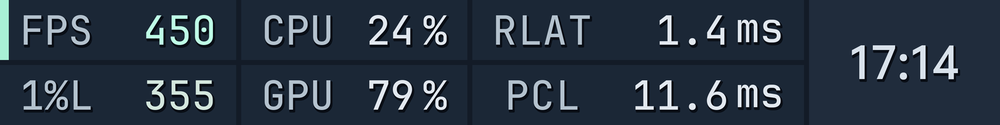
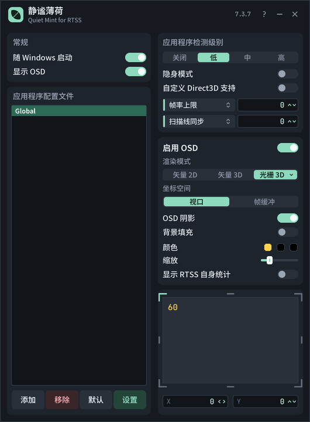

# 静谧薄荷 · Quiet Mint for RTSS

为 RivaTuner Statistics Server 设计的一套安静、克制的中文外观：
一块不抢画面的双行性能面板、一套从零绘制的深色皮肤，以及一份逐条重译的简体中文语言包。





### 包含什么

**性能面板** — 398 × 50 的双行 HUD：FPS、1% Low、CPU / GPU 占用、渲染延迟、PC 延迟与时钟。
深灰分组、薄荷色强调，数值区宽度固定，读数跳动时布局不晃。

**皮肤** — 卡片式布局、开关与分段按钮、等宽数码字体。
每一张位图都由 [`render_skin.py`](scripts/render_skin.py) 生成，可以完整复现。

**中文语言包** — 覆盖主程序、叠加层编辑器、热键与录制插件的全部界面文字，以及 87 篇悬停帮助。
依据 RTSS 自带的英文原文独立翻译，术语统一，格式占位符经过逐条校验。

**安装器** — 安装前自动备份，失败自动回滚，随时一键还原。

<br clear="right">

## 安装

1. 安装官方 [RTSS 7.3.7](https://www.guru3d.com/download/rtss-rivatuner-statistics-server-download/)。
2. 在 [Releases](../../releases) 下载补丁包，完整解压后运行 `安装补丁.cmd`。
3. 想撤销时运行 `还原补丁.cmd`。

> 仓库页面的 “Download ZIP” 是源码，不能直接安装。

1% Low、渲染延迟和 PC 延迟需要另外安装 NVIDIA FrameView SDK；缺少时对应读数显示 `--`，其余功能不受影响。
详见 [安装与还原](docs/INSTALL.md)。

## 数据从哪里来

| 读数 | 来源 |
|---|---|
| FPS | RTSS |
| CPU / GPU 占用 | RTSS 叠加层编辑器内置的硬件监控（HAL） |
| 1% Low · RLAT · PCL | 通过本项目的桥接插件读取 NVIDIA FrameView SDK |
| 时钟 | 桥接插件 |

- RLAT 指 Render Present Latency；PCL 指 PC Latency，并非完整的“鼠标到屏幕”端到端延迟，且需要游戏本身提供数据。
- 不需要常驻 MSI Afterburner。本项目只负责显示，不会提升帧率或降低延迟。

## 目录

```
src/bridge/          FrameView 数据桥接（RTSS 客户端插件）
src/skin/            皮肤源文件（由 render_skin.py 生成）
src/localization/    简体中文语言包（GBK / CRLF，RTSS 要求）
assets/overlay/      性能面板布局与图集
assets/fonts/        JetBrains Mono 及其许可证
scripts/             生成、构建、打包、安装脚本
```

从源码构建请看 [构建说明](docs/BUILD.md)；参与改进请看 [贡献指南](CONTRIBUTING.md)。

## 许可

本项目的代码、皮肤图形与中文译文由 BAOZOU 创作，以 [MIT](LICENSE) 发布。
随附字体与外部依赖见 [第三方声明](THIRD_PARTY_NOTICES.md)。

本项目与 RTSS、Guru3D、NVIDIA 无隶属关系；相关名称为其各自所有者的商标。
